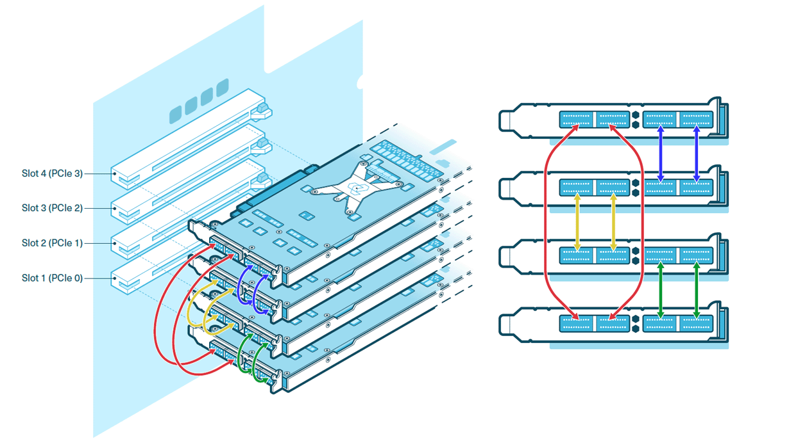

---
myst:
  html_meta:
    product-name: Blackhole p150a, Blackhole p150b, Tenstorrent
    technology-concepts: QSFP-DD, mesh, PCIe, cabling, topology
    document-type: how-to
---

# Multi-Card Topologies

The Blackhole p150a and p150b each have four passive QSFP-DD 800G ports. Cabling those ports to other Blackhole cards builds a mesh in which the cards exchange data directly, without going through the host's PCIe bus. This page covers Tenstorrent-validated 2-, 4-, and 8-card configurations, recommended cables, and how to check the result.

:::{note}
The p100a has no card-to-card ports and cannot join a mesh.
:::

:::{important}
The QSFP-DD ports connect only to other Blackhole-based cards. They are not standard Ethernet ports and do not connect to switches or network adapters.
:::

## Validated Configurations

Do not treat every configuration as a fully populated mesh. A card has four ports, but the validated configurations use only as many as their topology needs.

| Cards | Card Type       | Topology                 | External Cables |
| ----- | --------------- | ------------------------ | --------------- |
| 2     | p150a           | 1×2 mesh                 | 2               |
| 4     | p150a or p150b  | Ring of four (2×2 mesh)  | 8               |
| 8     | p150b           | 2×4 mesh                 | 10              |

:::{note}
The p150a and p150b are the Blackhole variants documented for multi-card operation. The p150a is intended for actively cooled desktop systems, and the p150b requires forced-air rack cooling. Mixing p150a and p150b cards in one mesh is not a documented configuration.
:::

If you would prefer a pre-built, validated desktop workstation powered by four Blackhole processors, please see the [TT-QuietBox 2](https://tenstorrent.com/hardware/tt-quietbox).

## Before You Cable

1. Confirm every card enumerates before you add cables. With the host powered on and no card-to-card cables connected, run `lspci -d 1e52:` and check that you see one entry per card. This separates PCIe problems from cabling problems.
2. Power off the host before connecting or disconnecting cables. After cabling, power back on and confirm the cards still enumerate.
3. Check case or rack clearance. The connectors face out of the bracket. Leave room behind the slots to route cables without sharp bends. See [Choosing Host Hardware](host-hardware.md#rear-clearance-for-qsfp-dd-cabling) for more details on ensuring clearance for mesh cables.
4. Number the cards and ports using the convention below, and label your cables before routing them.

## Cables

For standard short-reach setups, use validated 0.5m passive QSFP-DD 800G cables, available from the [Tenstorrent store](https://tenstorrent.com/hardware/cards). If you need more reach, these 1 m passive QSFP-DD 800G cables are recommended: [Amphenol SF-NJYYEK0001-001M](https://cablesondemand.com/qsfp-dd-direct-attach-cables-200g-400g-800g-dac-1/amphenol-sf-njyyek0001-001m-1m-3-3-800g-qsfp-dd-112g-cable-800-gigabit-ethernet-passive-direct-attach-qsfp-double-density-112g-cable-dual-entry-32-awg-qsfp-dd-112g-to-qsfp-dd-112g-sf-njyyek0001-001m) or <a href="https://www.fs.com/products/154259.html?attribute=36923&amp;id=3720628">FS QDD-800G-PC01</a>.

:::{important}
Use only passive QSFP-DD cables.
:::

## Port and Card Numbering

On p150a and p150b systems, Port 1 is the top connector, furthest from the motherboard, and Port 4 is the bottom connector, closest to the motherboard. In a rackmount system, number the cards from left to right, starting with Card 1 (or Tray 1).

```{image} ./images/bh_portspec.png
:width: 50%
```

*p150b pictured; the p150a has the same ports. Port 1 is the top connector.*

The diagrams on this page label cards C1, C2, and so on.

Each p150 card has one Blackhole chip, so a card-to-card link is also a chip-to-chip link. Each QSFP-DD cable carries two Ethernet links between the two cards it joins. The TT-Metalium software counts these links as *channels*, so one cable adds two channels between a pair of cards and two cables add four.

## Two Cards

### Supported Topology

Two p150a cards form a 1×2 mesh. TT-Metalium selects this topology automatically when it finds two p150 cards, using the `p150_x2` mesh graph descriptor, which expects four channels between the cards.

### Topology Description

The two cards connect directly to each other with two QSFP-DD cables. Two cables give four Ethernet links between C1 and C2. There are no intermediate hops.

```text
   +--------+    2 QSFP-DD cables     +--------+
   |   C1   |<======================> |   C2   |
   +--------+     (4 Ethernet links)  +--------+
```

### Port Configuration

Number the cards C1 and C2 by PCIe slot, with C1 in the lower-numbered slot. Connect two cables between the cards:

| Cable | From        | To          |
| ----- | ----------- | ----------- |
| 1     | C1 port TBD | C2 port TBD |
| 2     | C1 port TBD | C2 port TBD |

<!-- TODO: confirm the validated port assignment for two p150a cards before publishing. -->

### Required Cables

Buy **two** passive QSFP-DD 800G cables. A 0.5 m cable is long enough for cards in adjacent slots. Use a 1 m cable if the cards are farther apart. See [Cables](#cables).

### Other Possible Topologies

The following configurations can work but are not validated or tuned by Tenstorrent:

* **One cable (minimum).** The mesh still forms, because the `p150_x2` descriptor accepts fewer channels than it asks for. You get two Ethernet links instead of four, so card-to-card bandwidth is halved.
* **Three or four cables (maximum).** Each card has four ports, so up to four cables can join the two cards. The software is configured for four channels between the cards, so it may not use the extra links, and Tenstorrent has not tested this configuration.

## Four Cards

### Supported Topology

The recommended four-card topology is a ring of four cards, which TT-Metalium treats as a 2×2 mesh with the `p150_x4` mesh graph descriptor.

### Topology Description

Each card connects to two neighbors, forming a closed ring: C1–C2–C3–C4–C1. Every neighboring pair is joined by two cables, giving four Ethernet links per pair.

```text
   C1 ==== C2
   ||      ||
   C4 ==== C3
```

*Each `====` or `||` is two cables.*

TT-Metalium maps the ring to a 2×2 mesh, so each card has one neighbor along each mesh axis.

### Port Configuration

Number the cards by PCIe slot: C1 is in Slot 1 (PCIe 0), the slot nearest the bottom of the case, and C4 is in Slot 4 (PCIe 3). Connect eight cables:

| Cable | From     | To       |
| ----- | -------- | -------- |
| 1     | C1 port 3 | C2 port 3 |
| 2     | C1 port 4 | C2 port 4 |
| 3     | C2 port 1 | C3 port 1 |
| 4     | C2 port 2 | C3 port 2 |
| 5     | C3 port 3 | C4 port 3 |
| 6     | C3 port 4 | C4 port 4 |
| 7     | C4 port 1 | C1 port 1 |
| 8     | C4 port 2 | C1 port 2 |

Cables 7 and 8 span all four cards to close the ring, so route them first and check that they reach without tension.



*Four-card ring topology. Each color is one pair of cables.*

### Required Cables

Buy **eight** passive QSFP-DD 800G cables. Eight cables use all 16 ports on four cards. Cables 1 through 6 join adjacent slots. Cables 7 and 8 must reach from C4 to C1, so measure that distance in your case and choose a length that reaches without tension. See [Cables](#cables).

### Other Possible Topologies

The following configurations can work but are not validated or tuned by Tenstorrent:

* **Four cables (minimum for a 2×2 mesh).** One cable between each neighboring pair (cables 1, 3, 5, and 7 above) still closes the ring and forms the 2×2 mesh. Each pair has two Ethernet links instead of four, so card-to-card bandwidth is halved. With fewer than four cables the ring is open, and the software may not detect a 2×2 mesh.
* **1×4 line.** Some models treat the four cards as a line (C1–C2–C3–C4) instead of a 2×2 mesh. They use the same eight-cable ring, so no recabling is needed. Cabling only the line, without cables 7 and 8, is not tested.
* **No maximum beyond eight.** The eight-cable ring already uses every port.

## Eight Cards

### Supported Topology

Eight p150b cards form a 2×4 mesh, using the `p150_x8` mesh graph descriptor.

An eight-card mesh requires p150b cards in a rack-mounted server with forced-air cooling. See {doc}`Choosing Host Hardware <host-hardware>`.

### Topology Description

The cards form two rows of four. Cards 1–4 make one row and cards 5–8 make the other. Each card connects to the cards beside it in its row, and to the card in the same position in the other row. Each connection is one cable, giving two Ethernet links per neighboring pair.

```text
   C1 ---- C2 ---- C3 ---- C4
   |       |       |       |
   C5 ---- C6 ---- C7 ---- C8
```

There are no wraparound links. C1 and C4 are not connected, and the corner cards have only two neighbors.

### Port Configuration

Number the cards from left to right as seen from the rear of the server, C1 through C8. Connect ten cables:

| Cable | From      | To        | Connection     |
| ----- | --------- | --------- | -------------- |
| 1     | C1 port 3 | C2 port 4 | Row 1          |
| 2     | C2 port 3 | C3 port 4 | Row 1          |
| 3     | C3 port 3 | C4 port 4 | Row 1          |
| 4     | C5 port 3 | C6 port 4 | Row 2          |
| 5     | C6 port 3 | C7 port 4 | Row 2          |
| 6     | C7 port 3 | C8 port 4 | Row 2          |
| 7     | C1 port 2 | C5 port 1 | Between rows   |
| 8     | C2 port 2 | C6 port 1 | Between rows   |
| 9     | C3 port 2 | C7 port 1 | Between rows   |
| 10    | C4 port 2 | C8 port 1 | Between rows   |

:::{figure} ./images/bh_8card_2x4_mesh.jpg
:width: 80%
:::

### Required Cables

Buy **ten** passive QSFP-DD 800G 0.5 m cables.

:::{note}
An eight-card system has 32 ports, but the validated configuration uses ten cables (20 ports), not every port. The twelve open ports are the ones used to connect servers to each other. Do not cable them inside a single server.
:::

### Other Possible Topologies

The following configurations can work but are not validated or tuned by Tenstorrent:

* **Ten cables is the minimum for a 2×4 mesh.** Each neighboring pair has only one cable, so removing any cable leaves two neighbors with no direct link.
* **Extra single-server links.** The twelve open ports could add wraparound links (for example, C1 to C4) or a second cable between neighbors. TT-Metalium's `p150_x8` descriptor does not use these, and Tenstorrent cannot guarantee performance or error-free operation on topologies you create.
* **Multiple servers.** Two servers form a 4×4 mesh and four servers form an 8×4 mesh using the open ports. Multi-server scale-out is in development.

## Verify the Topology

For a single host, run the following command to ensure every card enumerates:

```bash
lspci -d 1e52:
```

You should see one `Tenstorrent Inc Blackhole` entry per Blackhole chip. A p100a, p150a or p150b has one chip, so you see one entry per card. 

For multi-node or descriptor-backed topology validation, use [`run_cluster_validation`](https://docs.tenstorrent.com/cloud-native-support/hardware-validation.html) with the expected cabling and deployment descriptors. The tool can print physical connectivity, send traffic across the detected links, and report missing or unhealthy connections.

As a functional check, run a multi-card workload such as the Llama 3.1 8B demo in [TT-Transformers](https://github.com/tenstorrent/tt-metal/tree/main/models/tt_transformers).

## Troubleshooting

### A card is missing from `lspci`

This is a PCIe problem, not a cabling problem. See [FAQ and Troubleshooting](faq.md#my-card-is-not-enumerating).

### Cards enumerate but the multi-card demo fails or is slow

Power off, reseat each cable until it clicks, and compare your wiring with the diagram for your system. Two swapped cables can leave the mesh looking connected but routing incorrectly.

### A cable will not seat or is under tension

Case clearance is too small or the cable is too short. Do not force it. See [Choosing Host Hardware](host-hardware.md#rear-clearance-for-qsfp-dd-cabling).

## Related pages

* {doc}`Choosing Host Hardware <host-hardware>`
* [TT-Topology](https://github.com/tenstorrent/tt-topology)
* {doc}`Blackhole PCIe Cards <index>`
