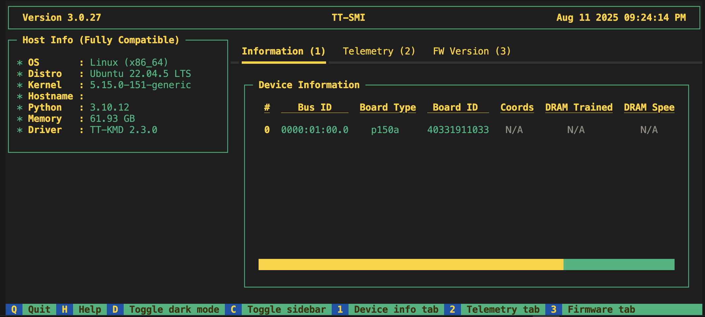

---
myst:
  html_meta:
    product-name: tt (Tenstorrent CLI), tt-cli, tt-installer, TT-SMI, TT-Inference-Server, TT-Studio
    technology-concepts: software installation, driver, firmware, model serving, OpenAI-compatible API, Docker
    document-type: how-to
---

# Installing Tenstorrent Software

This guide takes you from a fresh Tenstorrent system to one that is ready to run models. You will install the Tenstorrent CLI, `tt`, use it to update your system to the latest stable Tenstorrent software, and confirm your hardware is visible.

`tt` is the primary interface for operating your Tenstorrent hardware. If you want to develop against Tenstorrent's open-source repositories instead, start with [TT-Metalium™](https://docs.tenstorrent.com/tt-metal/latest/tt-metalium/), [TT-NN™](https://docs.tenstorrent.com/tt-metal/latest/ttnn/), or {doc}`TT-Forge™ <../forge/index>`.

## **Before You Begin**

:::{note}
Setting up your new TT-QuietBox® 2? Follow the [Setup Guide](../systems/quietbox/quietbox-bh-2/setup.md).
:::

Before you begin, ensure your host machine meets the following prerequisites:

* The host machine has an internet connection. `tt` downloads packages from PyPI and GitHub, the Tenstorrent package repositories, and model weights from the Hugging Face Hub.
* The host machine has a supported operating system installed (see below).
* You have administrator (`sudo`) privileges on the host machine. The driver, firmware tooling, and HugePages configuration are installed as root.
* The system is physically unboxed and set up according to your product's installation manual and safety guidelines.

### **Supported Operating Systems**

Tenstorrent recommends Ubuntu LTS for all Tenstorrent software.

| Operating system | Status |
|---|---|
| Ubuntu 22.04 LTS, Ubuntu 24.04 LTS | Supported |
| Other Linux distributions | Untested and considered experimental |
| macOS, Windows, WSL | Not supported. There is no driver, so nothing hardware-related works |

### **BIOS Requirements**

The BIOS for your host motherboard should configure the PCIe AER Reporting Mechanism to be set to `OS First`. Tenstorrent's TT-SMI software requires this setting to function properly.

:::{important}
If you are using a TT-QuietBox, you do not have to worry about setting this option. It is set to `OS First` by default.

If you update or reset your BIOS for any reason, you must reconfigure the PCIe AER Reporting Mechanism setting to `OS First` to ensure TT-SMI functions correctly. This setting is typically located in the **Motherboard Information** section of your BIOS.
:::

### **Install the Tenstorrent CLI Dependencies**

The Tenstorrent CLI, `tt`, is a Python application. It needs Python 3.10 or newer with the `venv` module, plus `git` and `curl`. Install them with your system package manager. On Ubuntu:

```bash
sudo apt update && sudo apt install -y python3 python3-venv python3-pip git curl ca-certificates
```

`tt` must live in its own isolated Python environment so that it can safely update itself later. Tenstorrent recommends [uv](https://docs.astral.sh/uv/) to manage that environment. Follow the setup instructions at [https://docs.astral.sh/uv/](https://docs.astral.sh/uv/) to install `uv`, then open a new terminal or source your shell configuration file (`source ~/.bashrc` for `bash`) so that `uv` is on your `PATH`.

:::{note}
If you already use [pipx](https://pipx.pypa.io/), it works too. Install `tt` with `pipx install tenstorrent` in the next step instead of the `uv` command. Other installation options are described in the [tt-cli developer notes](https://github.com/tenstorrent/tt-cli/blob/main/docs/DEVELOPERS.md#other-ways-to-install-tt-cli).
:::

---

## **Step 1: Install the Tenstorrent CLI**

:::{note}
If you're starting with a fresh TT-QuietBox® 2, we automatically install the Tenstorrent CLI for you. To check, run `tt --version` in your terminal. If you get a response, move to [Step 2](#step-2-install-the-software-stack-with-tt-update) below.
:::

Install `tt` as a `uv` tool and make sure it is on your `PATH`:

```bash
uv tool install tenstorrent
uv tool update-shell
```

Open a new terminal or source your shell configuration file again, then confirm `tt` runs:

```bash
tt --version
```

The first time you run `tt` in a terminal it asks once whether you want to share anonymous usage telemetry. Please consider saying yes. Telemetry tells Tenstorrent which commands people use, how long they take, and which ones fail, and that is what guides what gets fixed and built next. It is strictly opt-in and records no prompts, file paths, hostnames, usernames, or IP addresses. You can see exactly what would be sent before you decide: set `TT_TELEMETRY_LOG_FILE=/tmp/tt-events.jsonl` on any command and read the file, which works without opting in and uploads nothing. You can change your answer at any time with `tt config set telemetry.enabled true` or `false`. The [telemetry policy](https://github.com/tenstorrent/tt-cli/blob/main/TELEMETRY.md) lists everything that is collected.

Run `tt` to see the command groups. The ones used in this guide are `update` and `device`; `model`, `serve`, and `launch` take over once the stack is installed.

---

## **Step 2: Install the Software Stack with `tt update`**

Tenstorrent's system software stack consists of several components that are regularly tested together to ensure stability: device firmware, the kernel-mode driver (TT-KMD), HugePages configuration, TT-SMI, TT-Flash, and a container runtime for serving models. `tt update` brings your system up to the latest stable, tested combination of those components in one command. On a fresh machine it installs everything. On a machine that already has Tenstorrent software it changes only what is out of date, so you can rerun it at any time.

```bash
tt update
```

`tt update` installs the Tenstorrent tools into isolated environments under `~/.local/share/tenstorrent/`, where they cannot conflict with your own Python environment, then runs the matching [tt-installer](https://github.com/tenstorrent/tt-installer) release non-interactively to install the driver, firmware, HugePages configuration, and Docker if no container runtime is present.

:::{admonition} Required
:class: warning
**Using sudo is required, so you must enter your user's password when prompted.**

`tt update` also asks you to confirm before it flashes firmware, because flashing resets the devices. Stop any running model workloads first, then answer **y**.
:::

On a TT-QuietBox 2 with a fast connection the whole update takes a few minutes.

### **Bring `tt` itself up to date**

The installer that `tt update` runs also installs the `tt` release that was tested with that set of components, which can be older than the one you installed in Step 1. This page documents the latest release, so before you move on, put `tt` back on it:

```bash
tt self update
```

Keep both halves current over time: `tt update` for the system software and tools, and `tt self update` for `tt` itself. `tt` checks for a newer release once a day and prints a notice when one is available.

### **Reboot after the first install**

`tt update` never reboots your machine for you. If this is the first time the driver was installed on this machine, or HugePages configuration changed, **reboot now** before continuing:

```bash
sudo reboot
```

If `tt update` installed Docker, it also adds your user to the `docker` group. That takes effect when you log in again, which the reboot takes care of.

---

## **Step 3: Verify Your Hardware**

After rebooting, confirm the driver is loaded and that every Tenstorrent device in your system is visible:

```bash
tt device status
```

You should see one row per device, with the board type, PCIe bus address, and live telemetry. Here is an example from a TT-QuietBox 2 with four Blackhole p300 cards:

```
                Tenstorrent devices (driver: TT-KMD 2.11.0)
┏━━━┳━━━━━━━┳━━━━━━━━━━━━━━┳━━━━━━━━━┳━━━━━━━━┳━━━━━━━━━━━┳━━━━━━━━━┳━━━━━━┓
┃ # ┃ Board ┃ Bus ID       ┃ Temp    ┃ Power  ┃ AIClk     ┃ Voltage ┃ DRAM ┃
┡━━━╇━━━━━━━╇━━━━━━━━━━━━━━╇━━━━━━━━━╇━━━━━━━━╇━━━━━━━━━━━╇━━━━━━━━━╇━━━━━━┩
│ 0 │ p300c │ 0000:01:00.0 │ 43.9 °C │ 31.0 W │ 800.0 MHz │ 0.71 V  │ True │
│ 1 │ p300c │ 0000:02:00.0 │ 44.4 °C │ 17.0 W │ 800.0 MHz │ 0.71 V  │ True │
│ 2 │ p300c │ 0000:03:00.0 │ 43.6 °C │ 16.0 W │ 800.0 MHz │ 0.72 V  │ True │
│ 3 │ p300c │ 0000:04:00.0 │ 45.1 °C │ 16.0 W │ 800.0 MHz │ 0.72 V  │ True │
└───┴───────┴──────────────┴─────────┴────────┴───────────┴─────────┴──────┘
```

The number of rows should match the number of Tenstorrent devices installed in your system. For more detail on a device, such as its firmware versions and board ID, run `tt device info`. For a live, interactive view, run `tt smi`, which hands your terminal to the TT-SMI interface. Press **Q** to leave it.

Here is an example of the TT-SMI interface for a system containing a single p150a device:



:::{admonition} Important
:class: danger
If the number of listed devices does not match what you expect, see [Troubleshooting](#troubleshooting) below. If the problem persists, [contact support](#need-additional-support) and we will assist you.
:::

Congratulations, your system software is installed and your hardware is ready to use.

---

## **Troubleshooting**

### `tt device status` reports no devices

If `tt device status` exits with a message that the driver may not be installed or no card is seated:

1. If you have not rebooted since `tt update` installed the driver, reboot now.
2. Run `lspci -d 1e52` to check whether the card has enumerated on the PCIe bus. If it returns nothing, the host cannot see the card at all.
3. For Blackhole PCIe products such as p100 and p150, verify the card is being supplied power by checking that the fan spins and the green power LED illuminates when the system boots. If the light is on, try resetting the card with `tt device reset`.
4. Confirm the BIOS setting described in [BIOS Requirements](#bios-requirements).

### Docker commands are refused with a permission error

`tt` talks to Docker as your user, never through `sudo`. If `tt update` just installed Docker, log out and back in (or reboot) so that your membership in the `docker` group takes effect. You can check with `docker run hello-world`.

### Getting help

`tt report bundle` collects a redacted support bundle with your environment details, a TT-SMI snapshot, and recent logs, and opens a prefilled email to Tenstorrent support with it attached. `tt report issue` opens a prefilled GitHub issue on the tt-cli repository.

---

## **Alternative Installation Methods**

`tt update` is the recommended way to install the system software, and it runs tt-installer for you with the tested versions. If you prefer to drive [tt-installer](https://github.com/tenstorrent/tt-installer) interactively yourself and choose each of its options, you can run it directly:

```bash
/bin/bash -c "$(curl -fsSL https://tenstorrent.ai/install.sh)"
```

For advanced users or developers who prefer to install and configure each component by hand, refer to the [manual software installation guide](./manual-software-install.md).

---

## **What's Next**

With the software stack installed, `tt` takes you the rest of the way to a running model. `tt model list` shows the models validated for the hardware it detected, and `tt model info <model>` reports the disk space, host memory, and validation status of each one. Catalog models download their weights from the [Hugging Face Hub](https://huggingface.co), so log in once with `tt model login`; gated models such as Llama and Gemma also require accepting the license on the model's Hub page first. `tt serve <model>` then installs TT-Inference-Server, downloads the weights, and starts an OpenAI-compatible endpoint on port 20000, and `tt model curl "<prompt>"` sends it a first request. The first serve of a model downloads and compiles a lot, so expect it to take a while; later serves are much faster.

An endpoint is the foundation; `tt launch` puts an application on top of it. `tt launch openwebui` starts a chat interface in your browser, and `tt launch list` shows the other web UIs and terminal coding agents available on your machine. If you prefer a point-and-click experience, `tt serve <model> --studio` starts the model inside [TT-Studio](https://github.com/tenstorrent/tt-studio), a web application that serves models and gives you a browser interface for them in one place. Run `tt` at any time to see the command groups, and `tt <command> --help` for the options of each.

---

## **Where to Go Next**

You now have the full stack installed. From here, pick the part of the stack that matches what you want to build:

* **Deploy LLMs in production** with [TT-Inference-Server](./vLLM-servers.md), the serving engine behind `tt serve`. The [tt-inference-server repository](https://github.com/tenstorrent/tt-inference-server) is the authoritative source for which models are validated on your hardware.
* **Monitor your hardware** with `tt smi` for a status snapshot, or [TT-Toplike](https://docs.tenstorrent.com/tt-toplike/) for a live view of power, temperature, and core activity while a model serves requests.
* **Use a web interface** with [TT-Studio](https://github.com/tenstorrent/tt-studio), started through `tt serve <model> --studio`.
* **Understand the software stack**, including how TT-Forge™, TT-NN™, and TT-Metalium™ relate to each other, in the [software stack overview](./tt-software-stack.md).
* **Compile your own PyTorch, JAX, or ONNX models** with {doc}`TT-Forge™ <../forge/index>`.
* **Run and build models in Python** with [TT-NN™](https://docs.tenstorrent.com/tt-metal/latest/ttnn/), or **write custom kernels** with [TT-Metalium™](https://docs.tenstorrent.com/tt-metal/latest/tt-metalium/). `tt update` also installed a `tt-metalium` command that opens a shell inside the TT-Metalium container, with your home directory mounted and TT-NN ready to import; the image, about 4.5 GB, is pulled the first time you run it. Start with the [Metalium guide](https://github.com/tenstorrent/tt-metal/blob/main/METALIUM_GUIDE.md) to learn about the architecture.
* **Learn by building** with the hands-on lessons in the [TT VS Code Toolkit](https://docs.tenstorrent.com/tt-vscode-toolkit/).

---

## **Need Additional Support?**
If you encounter any issues, or have a question that isn't covered in the documentation, please [raise a support request.](https://tenstorrent.atlassian.net/servicedesk/customer/portal/1) Our team will review your request and provide assistance.
