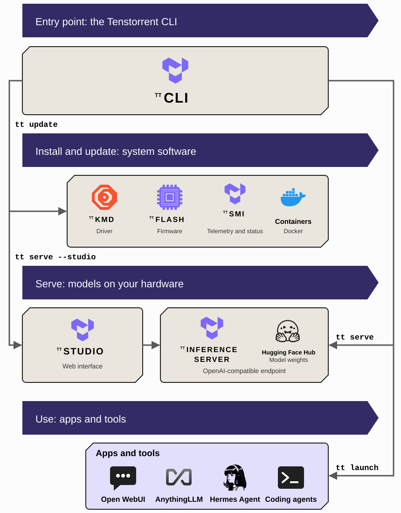

# Operating Tenstorrent Software

This document provides an overview of the main components you use to operate Tenstorrent hardware: the Tenstorrent CLI, `tt`, and TT-Studio. You will learn what each one is for, how they fit together with the software they manage, and where to find their source code. If you want to build on the stack instead, by compiling models or writing kernels, start with the [software stack overview](./tt-software-stack.md).

---

  

## `tt`: The Tenstorrent CLI

`tt` is the Tenstorrent command-line interface and the primary interface for operating your Tenstorrent hardware. It either implements a function itself or drives an existing Tenstorrent tool, such as TT-SMI or tt-installer, behind one stable set of commands.

Interact with `tt` to take a system from a fresh operating system install to a model answering requests, and to keep it that way. It installs and updates the system software, checks that your devices are visible and healthy, tells you which models are validated for the hardware it detects, serves a model as an OpenAI-compatible endpoint, and connects applications to that endpoint. Because it is a CLI, everything it does can be scripted and automated.

The main project is located in the [tt-cli](https://github.com/tenstorrent/tt-cli) GitHub repository. [Installing Tenstorrent Software](./README.md) walks through a first install with it.

---

## TT-Studio: The Web Interface

TT-Studio is a web application for running and using AI models on Tenstorrent hardware from a browser. It wraps the same serving engine that `tt serve` uses behind a point-and-click interface, so you choose a model from a list filtered to your hardware, deploy it, and use it without touching a terminal.

Interact with TT-Studio when you want to try a model from a browser, or hand a running system to people who do not use a command line. It provides an interface for each kind of model: chat with document knowledge bases for language models, image and video generation for diffusion models, speech-to-text for recognition models, object detection for vision models, and a voice agent that chains them together. Every model TT-Studio runs is also served on an API endpoint, so applications can use it at the same time as the browser does. `tt serve <model> --studio` starts TT-Studio and deploys a model in one step; it also runs on its own, and can point at endpoints on Tenstorrent hardware elsewhere.

The main project is located in the [tt-studio](https://github.com/tenstorrent/tt-studio) GitHub repository.

  

  

  

---

## What `tt` Manages

The diagram shows the layers that `tt` operates on your behalf. You rarely interact with them directly, but it helps to know what they are.

### System software

Tenstorrent's system software consists of several components that are regularly tested together: the kernel-mode driver (TT-KMD) that exposes the devices to Linux, the device firmware and the TT-Flash tool that writes it, the HugePages memory configuration the devices need, TT-SMI for telemetry and status, and a container runtime, normally Docker, that the serving engine runs in. `tt update` brings a system onto the latest stable, tested combination of these in one command, using [tt-installer](https://github.com/tenstorrent/tt-installer) for the parts that install as root. `tt device` and `tt smi` read the result: which devices are present, their temperature, power, and clocks, and their firmware versions.

### Model serving

[TT-Inference-Server](https://github.com/tenstorrent/tt-inference-server) is the serving engine behind both `tt serve` and TT-Studio. It packages each model with the right runtime in a container, downloads the model's weights from the [Hugging Face Hub](https://huggingface.co), and exposes an OpenAI-compatible API endpoint. The models it ships and tests make up the catalog that `tt model list` shows for your hardware, filtered to the configuration `tt` detects. The catalog is not limited to large language models: it includes diffusion models for image and video generation, speech and audio models, and vision models. Alongside it, community bundles that anyone has published to the Hub for Tenstorrent hardware can be served through the same commands; Tenstorrent does not test or maintain those. The tt-inference-server repository is the authoritative source for which models are validated on each hardware generation.

### Apps and tools

An endpoint is the foundation; applications are what you use. `tt launch` connects ready-made clients to the model being served: web UIs such as [Open WebUI](https://github.com/open-webui/open-webui) and [AnythingLLM](https://github.com/Mintplex-Labs/anything-llm), which `tt` pulls and runs for you in a container, and terminal coding agents such as OpenCode, Aider, pi, Qwen Code, and Hermes Agent, which you install yourself and `tt` configures to reach your model. Because the endpoint speaks the OpenAI API, any other OpenAI-compatible client works too.

---

## Choosing Between `tt` and TT-Studio

Both paths run the same models on the same serving engine, and a model served by one is reachable from the other, so the choice is about how you want to work:

* **Use `tt`** when you want an API endpoint for applications, scripts, or agents, when you are setting up or maintaining a system, or when you want to automate any of that.
* **Use TT-Studio** when you want to try models from a browser, when the people using the system are not terminal users, or when you want the built-in chat, generation, and recognition interfaces without connecting a separate client.

For monitoring your hardware while models run, `tt smi` gives a status snapshot and [TT-Toplike](https://docs.tenstorrent.com/tt-toplike/) reads power, temperature, and core activity in real time from the chips.

---

## Where to Go Next

* **Set up a system** with [Installing Tenstorrent Software](./README.md): install `tt`, update the system software, and verify your hardware.
* **Serve more kinds of models** with the [Serve Models](./serve-models.md) guide, which walks the catalog, `tt serve`, and TT-Studio with a diffusion model as the example.
* **Deploy LLMs in production** with [TT-Inference-Server](./vLLM-servers.md) directly.
* **Build on the stack** by reading the [software stack overview](./tt-software-stack.md), which introduces TT-Forge™, TT-NN™, and TT-Metalium™.

As always, if you have any questions, please [raise a support request](https://tenstorrent.atlassian.net/servicedesk/customer/portal/1) with our team.

---

<nav class="doc-footer-buttons" role="navigation" aria-label="Page navigation">
  <a href="tt-software-stack.html" class="btn btn-neutral">Previous</a>
  <a href="README.html" class="btn btn-neutral">Next</a>
</nav>
