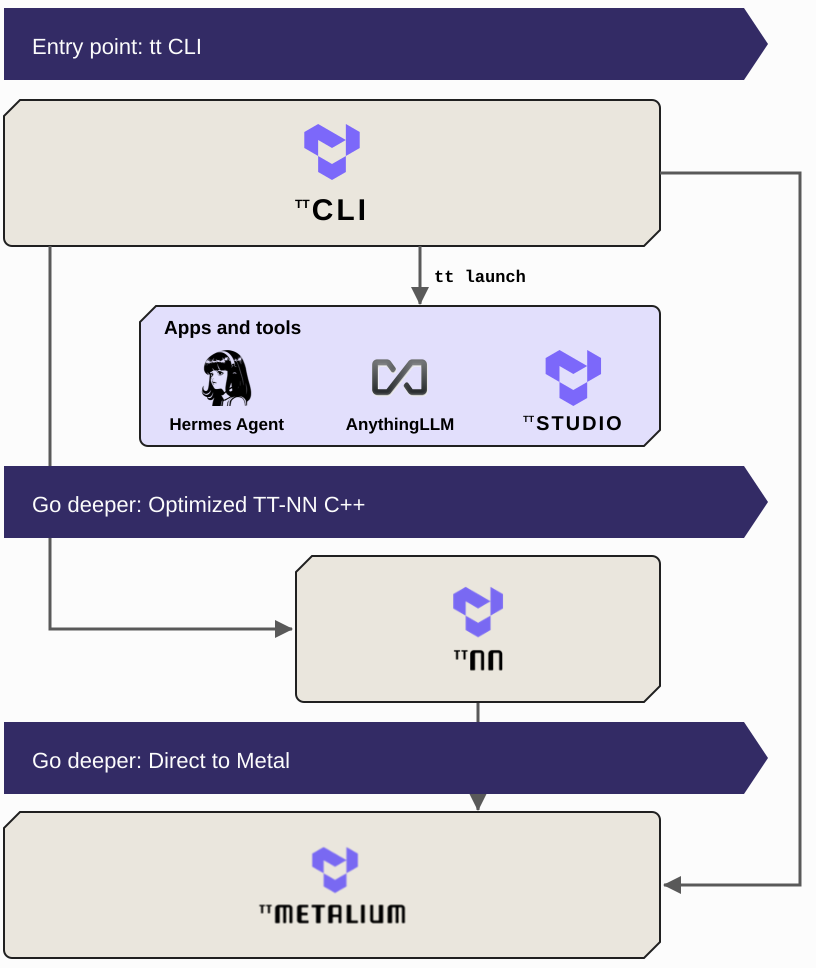

# Overview

This document provides developers and researchers with an overview of the main components of the Tenstorrent software stack: the `tt` CLI, TT-NN™, and TT-Metalium™. You will learn about each tool's purpose, use cases, and where to find its source code.

---

  

## `tt` CLI: The Entry Point to the Stack

`tt` is the Tenstorrent command-line interface and the single entry point to the software stack. It installs and updates every layer of the stack, from the driver and firmware to TT-Metalium™, as one tested set, and it is the interface through which you check your hardware, find a model that runs on it, serve that model, and connect applications to it.

Interact with `tt` whenever you work with Tenstorrent hardware. `tt update` brings a system to the latest tested versions, `tt device` checks and resets the hardware, `tt model` browses the model catalog, and `tt serve` deploys a model as an OpenAI-compatible endpoint. From that endpoint, `tt launch` connects the applications you want to use with the model: web interfaces such as Open WebUI and AnythingLLM, agent harnesses such as Hermes Agent, OpenCode, Aider, pi, and Qwen Code, and other tools. When you are ready to go deeper, `tt` is where you branch off into the layers below: `tt update` also installs a `tt-metalium` command that opens the TT-Metalium™ development container, with TT-NN™ ready to import.

[Installing Tenstorrent Software](./README.md) walks through installing the CLI and serving a first model. The main project is located in the [tt-cli](https://github.com/tenstorrent/tt-cli) GitHub repository.

---

## TT-NN™: A Python & C++ Neural Network OP library

TT-NN™ is a library of neural network operations that provides a user-friendly interface for running models on Tenstorrent hardware. It is designed to be intuitive for developers familiar with [PyTorch](https://pytorch.org).

Interact with TT-NN™ to run AI models using a familiar, high-level Python API without managing the complexities of the underlying hardware. TT-NN™ builds upon TT-Metalium™ and provides a stable set of pre-packaged, optimized operations. It is also available with a C++ API.

The TT-NN™ library is part of the [tt-metal](https://github.com/tenstorrent/tt-metal) GitHub repository.

  

  

  

---

## TT-Metalium™: Programming Tenstorrent Hardware

TT-Metalium™ is the low-level, open-source software development kit (SDK) that provides developers direct access to Tenstorrent hardware. It is a bare-metal programming environment designed for users who must write custom C++ kernels for machine learning or other high-performance computing workloads.

Interact with TT-Metalium™ when you require complete control over the hardware to optimize code for performance, explicitly manage memory, or implement novel operations not found in standard libraries. This environment exposes the RISC-V processors, the Network-on-Chip (NoC), and the matrix and vector engines within each Tensix core.

The main project is available in the [tt-metal](https://github.com/tenstorrent/tt-metal) GitHub repository.

---

## Running Models on Hardware

`tt serve <model>` is how you run a model on Tenstorrent hardware. The models it serves are the catalog that `tt model list` shows for your hardware: one list, with all supported models in one place. Tenstorrent-verified models have passed Tenstorrent's CI gates; community-published models are bundles that their authors, inside or outside Tenstorrent, published under their own Hugging Face accounts, and they carry the author's name.

Whichever model you pick, `tt serve` does the same work for you:

1. **Bring down the model package.** For a model that ships with the inference server, `tt` downloads the weights and pulls the container image that holds the serving engine for that kind of model. For a community-published model, it pulls the bundle from the Hugging Face Hub, the engine the author built with their kernels inside, and then the weights the bundle points to, into the same cache.
2. **Launch the server.** `tt` starts the container, which opens the Tenstorrent devices, loads the weights, prepares the model (an LLM sizes its KV cache and warms up), and starts the API server.
3. **Serve the model.** `tt` watches the boot as a checklist and returns when the endpoint answers at `http://localhost:20000/v1`, speaking the OpenAI API. Later serves skip the downloads, because the weights and images stay cached on your machine.

TT-Studio deploys the same catalog from a browser; `tt serve <model> --studio` starts it. [Deploy Models](./deploy-models.md) walks through both surfaces. For monitoring your hardware while models run, [TT-Toplike](https://docs.tenstorrent.com/tt-toplike/) reads power, temperature, and core activity in real time from the chips.

---

## Exploring our Developer Hub

To continue learning, visit and explore our [Developer Hub](https://tenstorrent.com/developers). There you will find in-depth articles, and information on our software bounty program. You can also find tutorials and technical overviews on our [YouTube channel](https://www.youtube.com/@tenstorrentinc).

---

## Engaging with our Community

For real-time discussions, community Q&A, and to share your latest projects, we invite you to join our [Discord channel](https://discord.gg/tenstorrent). It's a great place to engage directly with other developers and members of the Tenstorrent community.

As always, if you have any questions, please [raise a support request](https://tenstorrent.atlassian.net/servicedesk/customer/portal/1) with our team. We're here to help, and are excited to see what you build.

---

<nav class="doc-footer-buttons" role="navigation" aria-label="Page navigation">
  <a href="deploy-models.html" class="btn btn-neutral">Previous</a>
  <a href="../aibs/index.html" class="btn btn-neutral">Next</a>
</nav>
